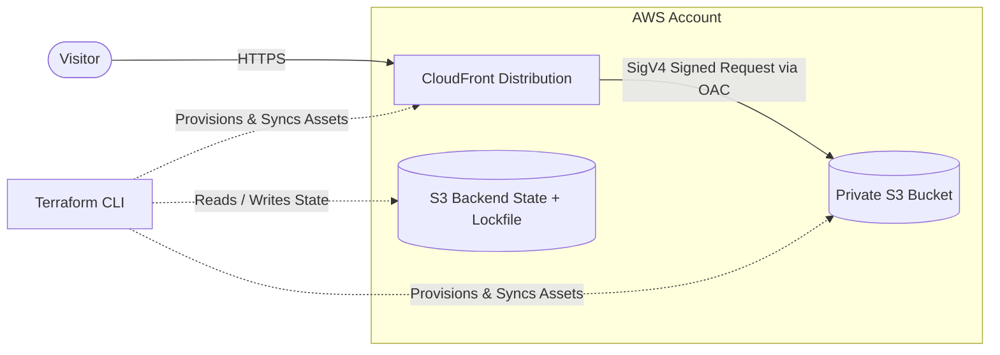
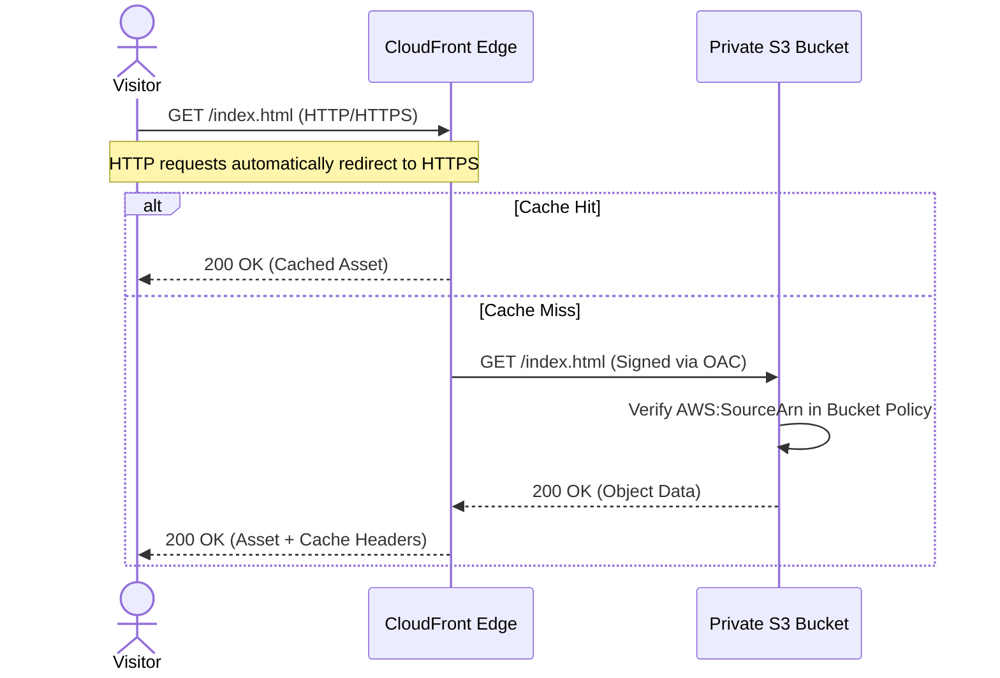

# Static Website Hosting on AWS (S3 + CloudFront + OAC)

Terraform configuration for hosting a static website on AWS using a private Amazon S3 bucket behind an Amazon CloudFront distribution. Public access to the S3 bucket is completely blocked, and all traffic is routed securely over HTTPS using CloudFront Origin Access Control (OAC).

## Architecture

Instead of enabling S3 static website hosting (which requires public bucket access over HTTP), this setup treats S3 as a private REST API origin. CloudFront signs every origin request with AWS Signature Version 4 (SigV4), and the S3 bucket policy permits `s3:GetObject` calls only when they originate from this specific CloudFront distribution.



### Request Flow



## Key Details

* **Security First:** All four S3 public access block settings are enabled (`block_public_acls`, `block_public_policy`, `ignore_public_acls`, `restrict_public_buckets`), and the bucket policy restricts access strictly to `://amazonaws.com` via `AWS:SourceArn`.
* **Unique Bucket Naming:** Appends an 8-character lowercase random suffix (`random_string`) to the project name to avoid global S3 namespace collisions.
* **CDN & Caching Defaults:**
  * **Default Root Object:** `index.html`
  * **Allowed / Cached Methods:** `GET`, `HEAD`
  * **TTL Settings:** Min `0s` / Default `3600s` (1 hour) / Max `86400s` (24 hours)
  * **Edge Locations:** `PriceClass_100` (North America, Europe, and Israel) with IPv6 enabled
* **Automatic Asset Sync:** Recursively uploads everything inside `./staticfiles` using `fileset` and `filemd5` ETags so Terraform detects file changes automatically.
* **MIME Type Mapping:** Automatically sets `Content-Type` headers for `.html`, `.css`, `.js`, `.json`, `.png`, `.jpg`, `.jpeg`, `.gif`, `.svg`, `.ico`, and `.txt` (defaulting to `application/octet-stream` for other extensions).
* **Remote State:** Stores state encrypted in S3 (`learning-tf-state-2026`) with Terraform's native S3 lockfile mechanism (`use_lockfile = true`).

## Prerequisites

* **Terraform** `>= 1.10` (required for native `use_lockfile` S3 state locking)
* **AWS CLI** configured with credentials that have permissions for S3 and CloudFront
* **Remote State Bucket:** An existing S3 bucket named `learning-tf-state-2026` in `us-east-1` (update `backend.tf` if using your own bucket)

## Repository Files

* `backend.tf` — S3 remote state backend with encryption and native lockfile enabled
* `cloudfront.tf` — CloudFront Origin Access Control (OAC) and distribution configuration
* `locals.tf` — Standardized naming locals for the OAC and S3 origin ID
* `outputs.tf` — Outputs for the CloudFront distribution ID and generated S3 bucket name
* `providers.tf` — Provider requirements (`hashicorp/aws ~> 6.0` and `hashicorp/random ~> 3.6`)
* `s3.tf` — AWS provider block, S3 bucket, public access block, CloudFront bucket policy, and local file upload resource
* `variables.tf` — Input variables (`region`, `projectname`, `tags`)

## Getting Started

1. **Add your website files:**
   Create a `staticfiles/` directory in the project root and place your static assets inside it (make sure `index.html` is at the root of `staticfiles/`):
   ```bash
   mkdir -p staticfiles
   ```

2. **Initialize Terraform:**
   ```bash
   terraform init
   ```

3. **Preview the changes:**
   ```bash
   terraform plan
   ```

4. **Apply the configuration:**
   ```bash
   terraform apply
   ```

5. **Open your site:**
   Grab the distribution domain name (e.g., `d1234abcd.cloudfront.net`) from the CloudFront console—or add `aws_cloudfront_distribution.s3_distribution.domain_name` to `outputs.tf`—and visit it in your browser.

## Inputs & Outputs

### Inputs (`variables.tf`)

| Variable | Description | Type | Default |
|----------|-------------|------|---------|
| `region` | AWS region for resource deployment | `string` | `"us-east-1"` |
| `projectname` | Prefix for the S3 bucket and OAC names | `string` | `"cdn-s3-site"` |
| `tags` | Resource tags applied to the S3 bucket | `map(string)` | `{ Environment = "dev", Name = "dev-bucket", Project = "StaticWebSite" }` |

### Outputs (`outputs.tf`)

| Output | Description |
|--------|-------------|
| `cloudfront-id` | ID of the provisioned CloudFront distribution |
| `s3bucket-name` | Full generated name of the S3 bucket (including random suffix) |

## Troubleshooting & Notes

* **Updates not showing immediately:** CloudFront caches files for up to 1 hour (`default_ttl = 3600`) by default. After updating files in `staticfiles/` and running `terraform apply`, create a CloudFront cache invalidation (`/*`) if you need changes to appear right away.
* **403 AccessDenied errors:** Verify that `index.html` exists directly inside `staticfiles/index.html` (not nested inside a subfolder), as CloudFront looks for `default_root_object = "index.html"` at the bucket root.

## Cleanup

To tear down the CloudFront distribution, S3 objects, and S3 bucket:

```bash
terraform destroy
```
