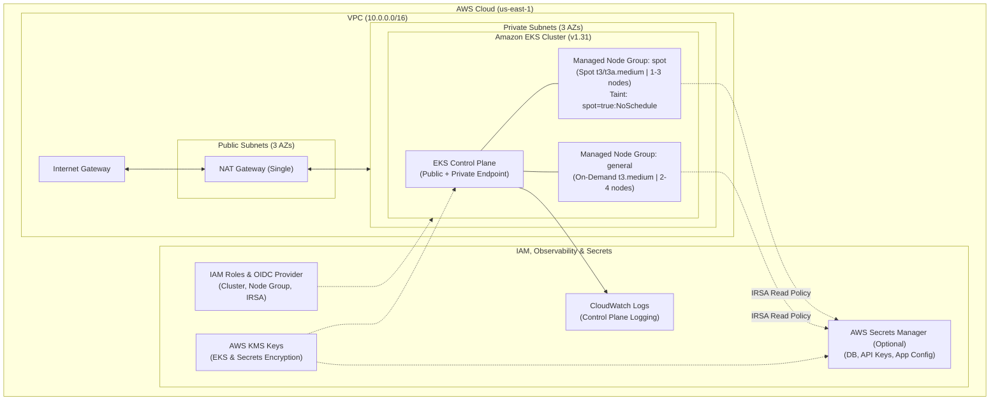
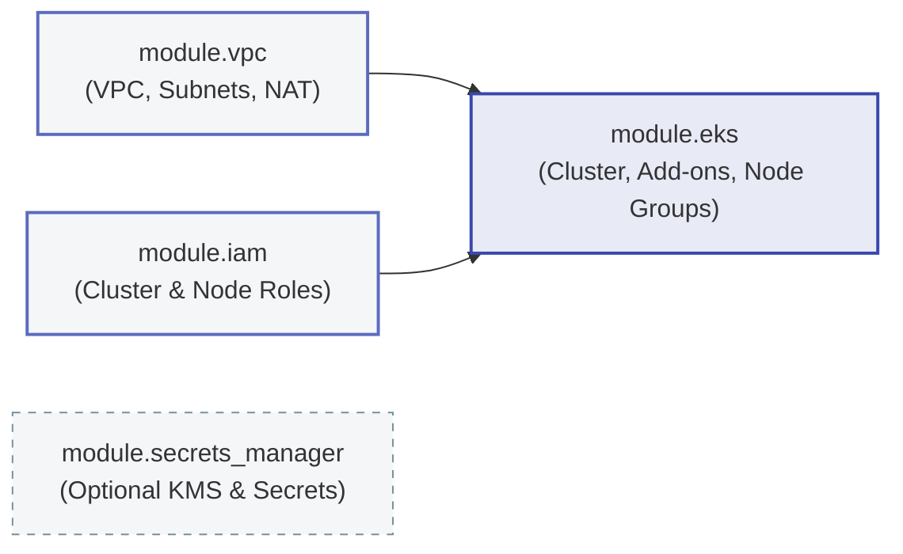

# AWS EKS Infrastructure with Custom Terraform Modules

This repository contains Terraform configurations to provision an Amazon EKS cluster using modular, reusable infrastructure components. It builds out the underlying VPC networking, IAM roles, managed node groups (On-Demand and Spot), core EKS add-ons, CloudWatch logging, and optional AWS Secrets Manager integrations.

## Architecture Overview

### AWS Infrastructure & Network Topology



### Terraform Module Dependencies



### Core Components

* **VPC (`./modules/vpc`):** Creates a custom VPC spanning 3 Availability Zones with public and private subnets, an Internet Gateway, dedicated route tables, and NAT Gateway support (`single_nat_gateway` enabled by default to minimize costs). Automatically applies required `kubernetes.io/role/*` subnet tags for AWS Load Balancer Controller discovery.
* **IAM (`./modules/iam`):** Provisions least-privilege IAM roles for the EKS control plane and worker node groups.
* **EKS (`./modules/eks`):** Deploys the EKS control plane (Kubernetes `1.31`), dedicated cluster and node security groups, a KMS key for envelope encryption, CloudWatch control plane logging, an OIDC provider for IAM Roles for Service Accounts (IRSA), core add-ons (`coredns`, `kube-proxy`, `vpc-cni`), and two managed node groups:
  * `general`: On-Demand `t3.medium` instances (`min: 2, desired: 2, max: 4`) labeled `role=general`.
  * `spot`: Spot `t3.medium` / `t3a.medium` instances (`min: 1, desired: 1, max: 3`) labeled `role=spot` and tainted with `spot=true:NoSchedule`.
* **Secrets Manager (`./modules/secrets-manager`):** Conditionally provisions a dedicated KMS encryption key, secrets for database credentials, API keys, and application config maps, plus a scoped IAM read policy (`read_secrets_policy_arn`) for workloads to consume them.

## Repository Structure

```text
.
|-- backend.tf # S3 remote state configuration with native state locking
|-- main.tf # Root module orchestration
|-- outputs.tf # Exposed cluster endpoints, ARNs, and kubeconfig helper
|-- provider.tf # Terraform (>= 1.3) and AWS provider (~> 6.73.0) constraints
|-- variables.tf # Root input variable definitions
`-- modules/
    |-- eks/ # Control plane, security groups, KMS, IRSA, add-ons & node groups
    |-- iam/ # Control plane and node group IAM roles
    |-- secrets-manager/ # Conditional KMS key, Secrets Manager secrets & read IAM policy
    `-- vpc/ # VPC, public/private subnets, IGW, NAT Gateway & route tables
```

## Prerequisites

* [Terraform](https://hashicorp.com) `>= 1.3`
* [AWS CLI](https://amazon.com) configured with credentials having permissions to create VPC, IAM, EKS, KMS, CloudWatch, and Secrets Manager resources
* [kubectl](https://kubernetes.io) for cluster management
* An existing S3 bucket (`learning-tf-state-2026`) in `us-east-1` for Terraform remote state

## Quick Start

### 1. Verify Remote Backend
Confirm that the S3 bucket defined in `backend.tf` exists before initializing, or update the block to match your state bucket:
```hcl
terraform {
  backend "s3" {
    bucket       = "learning-tf-state-2026"
    key          = "terraform-aws-eks/terraform.tfstate"
    region       = "us-east-1"
    encrypt      = true
    use_lockfile = true
  }
}
```

### 2. Configure Variables (Optional)
Create a `terraform.tfvars` file to override defaults or enable optional Secrets Manager resources:
```hcl
aws_region         = "us-east-1"
cluster_name       = "day20-eks"
kubernetes_version = "1.31"
environment        = "development"

# Optional: Enable Secrets Manager secrets
enable_db_secret   = true
db_username        = "app_user"
db_password        = "ChangeMe123!"
db_engine          = "postgres"
db_host            = "postgres.internal"
db_port            = 5432
db_name            = "appdb"
```

### 3. Deploy
```bash
terraform init
terraform plan -out=tfplan
terraform apply tfplan
```

### 4. Configure `kubectl`
Once deployment completes, run the command generated by the `configure_kubectl` output:
```bash
\$(terraform output -raw configure_kubectl)
kubectl get nodes -o wide
```

## Root Module Inputs

### Core Configuration

| Name | Description | Type | Default |
|------|-------------|------|---------|
| `aws_region` | AWS region where resources will be created | `string` | `"us-east-1"` |
| `cluster_name` | Name of the EKS cluster | `string` | `"day20-eks"` |
| `kubernetes_version` | Kubernetes version for the EKS cluster | `string` | `"1.31"` |
| `environment` | Environment name applied to resource tags | `string` | `"development"` |
| `vpc_cidr` | CIDR block for the VPC | `string` | `"10.0.0.0/16"` |
| `private_subnets` | List of private subnet CIDR blocks | `list(string)` | `["10.0.1.0/24", "10.0.2.0/24", "10.0.3.0/24"]` |
| `public_subnets` | List of public subnet CIDR blocks | `list(string)` | `["10.0.101.0/24", "10.0.102.0/24", "10.0.103.0/24"]` |

### Optional Secrets Manager Configuration

| Name | Description | Type | Default | Sensitive |
|------|-------------|------|---------|-----------|
| `enable_db_secret` | Enable database credentials secret | `bool` | `false` | No |
| `db_username` | Database username | `string` | `""` | Yes |
| `db_password` | Database password | `string` | `""` | Yes |
| `db_engine` | Database engine | `string` | `"postgres"` | No |
| `db_host` | Database host | `string` | `""` | No |
| `db_port` | Database port | `number` | `5432` | No |
| `db_name` | Database name | `string` | `""` | No |
| `enable_api_secret` | Enable API keys secret | `bool` | `false` | No |
| `api_key` | API key | `string` | `""` | Yes |
| `api_secret` | API secret | `string` | `""` | Yes |
| `enable_app_config_secret` | Enable application config secret | `bool` | `false` | No |
| `app_config` | Application configuration key-value map | `map(string)` | `{}` | Yes |

## Root Module Outputs

| Name | Description |
|------|-------------|
| `vpc_id` | ID of the created VPC |
| `private_subnets` | List of private subnet IDs |
| `public_subnets` | List of public subnet IDs |
| `nat_gateway_ips` | Public IPs of the NAT Gateways |
| `cluster_iam_role_arn` | IAM role ARN of the EKS control plane |
| `node_iam_role_arn` | IAM role ARN of the managed node groups |
| `oidc_provider_arn` | ARN of the OIDC provider for IRSA |
| `cluster_id` / `cluster_name` | ID and name of the EKS cluster |
| `cluster_endpoint` | Endpoint URL for the EKS Kubernetes API server |
| `cluster_version` | Active Kubernetes version of the cluster |
| `cluster_security_group_id` | Security group ID attached to the EKS control plane |
| `node_security_group_id` | Security group ID attached to the EKS worker nodes |
| `cluster_oidc_issuer_url` | OIDC issuer URL for the EKS cluster |
| `kms_key_arn` | KMS key ARN used for EKS secrets envelope encryption |
| `secrets_kms_key_arn` | KMS key ARN used for Secrets Manager encryption (if enabled) |
| `db_secret_arn` | ARN of the database credentials secret (if enabled) |
| `api_secret_arn` | ARN of the API keys secret (if enabled) |
| `app_config_secret_arn` | ARN of the application config secret (if enabled) |
| `configure_kubectl` | Ready-to-run AWS CLI command to update local `kubeconfig` |

## Child Modules Reference

Each module under `./modules/` is self-contained and exposes additional granular outputs (such as route table IDs, CloudWatch log group names, and the `read_secrets_policy_arn` IAM policy) if you want to reuse them independently:

* **`./modules/vpc`**: Accepts `name_prefix`, `vpc_cidr`, `azs`, `private_subnets`, `public_subnets`, `enable_nat_gateway`, and `single_nat_gateway`. Outputs subnet IDs/CIDRs, IGW ID, NAT Gateway IDs/EIPs, and route table IDs.
* **`./modules/iam`**: Accepts `cluster_name` and `tags`. Outputs `cluster_role_arn/name` and `node_group_role_arn/name`.
* **`./modules/eks`**: Accepts cluster networking, IAM roles, `endpoint_public_access`/`endpoint_private_access`, `public_access_cidrs`, `node_groups` map, `enable_irsa`, and optional add-on versions (`coredns_version`, `kube_proxy_version`, `vpc_cni_version`). Outputs cluster details, security groups, KMS key details, CloudWatch log group name, and OIDC provider details.
* **`./modules/secrets-manager`**: Accepts `name_prefix` and boolean toggles (`create_db_secret`, `create_api_secret`, `create_app_config_secret`). Outputs secret ARNs/names, KMS key details, and a pre-built IAM read policy (`read_secrets_policy_arn`) ready to attach to IRSA roles.

## Cleanup

Delete any Kubernetes services of type `LoadBalancer` or dynamically provisioned EBS volumes before destroying the stack so AWS network interfaces and security groups release cleanly:

```bash
terraform destroy
```
