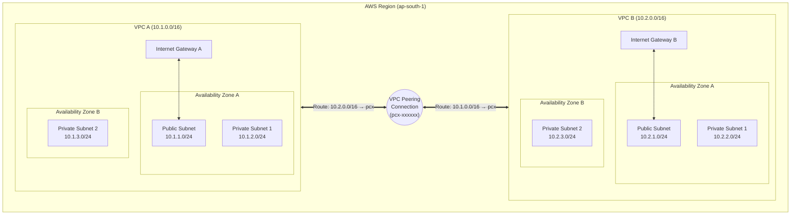
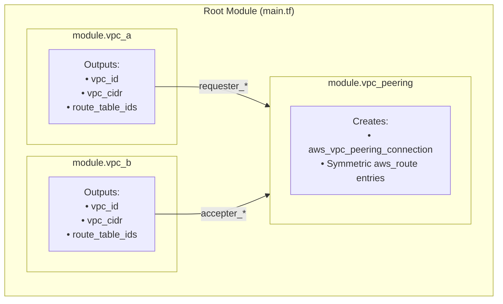

# AWS VPC & VPC Peering Infrastructure with Terraform


This repository provisions two isolated Amazon Virtual Private Clouds (**VPC A** and **VPC B**) across multiple Availability Zones and establishes a bidirectional **VPC Peering** connection between them using reusable local Terraform modules and shared Amazon S3 remote state.

---

## Table of Contents

- [Architecture Overview](#architecture-overview)
- [Network & CIDR Allocation](#network--cidr-allocation)
- [Module Data Flow](#module-data-flow)
- [Project Structure](#project-structure)
- [Prerequisites](#prerequisites)
- [Remote State Management (S3 Backend)](#remote-state-management-s3-backend)
- [Getting Started](#getting-started)
- [Module Reference](#module-reference)
  - [VPC Module (`modules/vpc`)](#vpc-module-modulesvpc)
  - [VPC Peering Module (`modules/vpc-peering`)](#vpc-peering-module-modulesvpc-peering)
- [Verification & Connectivity Testing](#verification--connectivity-testing)
- [Cleanup](#cleanup)

---

## Architecture Overview

The deployment builds two multi-AZ VPCs with non-overlapping IPv4 CIDR blocks (`10.1.0.0/16` and `10.2.0.0/16`). Each VPC contains one public subnet (with Internet Gateway access) and two private subnets distributed across two Availability Zones. A VPC Peering connection links both VPCs, with symmetric routes injected into all public and private route tables.



---

## Network & CIDR Allocation

All subnets use a `/24` mask (256 total IPs; **251 usable IPs** after accounting for the 5 IP addresses AWS reserves per subnet).

### VPC A (`10.1.0.0/16`)

| Subnet Name | Tier | CIDR Block | Availability Zone | Routing Behavior |
| :--- | :--- | :--- | :--- | :--- |
| `vpc-a-public-subnet` | Public | `10.1.1.0/24` | `ap-south-1a` | `0.0.0.0/0` → IGW A, `10.2.0.0/16` → Peering |
| `vpc-a-private-subnet-1` | Private | `10.1.2.0/24` | `ap-south-1a` | `10.2.0.0/16` → Peering (Local-only internet) |
| `vpc-a-private-subnet-2` | Private | `10.1.3.0/24` | `ap-south-1b` | `10.2.0.0/16` → Peering (Local-only internet) |

### VPC B (`10.2.0.0/16`)

| Subnet Name | Tier | CIDR Block | Availability Zone | Routing Behavior |
| :--- | :--- | :--- | :--- | :--- |
| `vpc-b-public-subnet` | Public | `10.2.1.0/24` | `ap-south-1a` | `0.0.0.0/0` → IGW B, `10.1.0.0/16` → Peering |
| `vpc-b-private-subnet-1` | Private | `10.2.2.0/24` | `ap-south-1a` | `10.1.0.0/16` → Peering (Local-only internet) |
| `vpc-b-private-subnet-2` | Private | `10.2.3.0/24` | `ap-south-1b` | `10.1.0.0/16` → Peering (Local-only internet) |

---

## Module Data Flow

The root configuration orchestrates resource creation and dependency resolution by passing outputs from `module.vpc_a` and `module.vpc_b` directly into `module.vpc_peering`.



---

## Project Structure

```text
terraform-vpc-peering/
├── backend.tf                  # S3 remote state & native lockfile configuration
├── main.tf                     # Root module invoking vpc_a, vpc_b, and vpc_peering
├── providers.tf                # Terraform & AWS provider version constraints
├── outputs.tf                  # Root outputs exposing VPC IDs and Peering ID
├── README.md                   # Project documentation
└── modules/
    ├── vpc/                    # Reusable VPC, Subnet, IGW, and Route Table module
    │   ├── main.tf
    │   ├── variables.tf
    │   └── outputs.tf
    └── vpc-peering/            # Reusable VPC Peering and symmetric routing module
        ├── main.tf
        ├── variables.tf
        └── outputs.tf
```

---

## Prerequisites

Before deploying this infrastructure, ensure you have:

1. **Terraform CLI** (`>= 1.10.0`) installed locally (required for native S3 state locking via `use_lockfile = true`).
2. **AWS CLI** configured with valid credentials (`aws configure`) or exported environment variables (`AWS_ACCESS_KEY_ID`, `AWS_SECRET_ACCESS_KEY`, `AWS_DEFAULT_REGION`).
3. **IAM Permissions** allowing:
   * Amazon VPC operations (`ec2:CreateVpc`, `ec2:CreateSubnet`, `ec2:CreateInternetGateway`, `ec2:CreateRouteTable`, `ec2:CreateVpcPeeringConnection`, `ec2:AcceptVpcPeeringConnection`, `ec2:CreateRoute`, and corresponding `Describe*` / `Delete*` actions).
   * Amazon S3 state bucket access (`s3:ListBucket`, `s3:GetObject`, `s3:PutObject`, `s3:DeleteObject`).

---

## Remote State Management (S3 Backend)

To allow multiple team members to collaborate safely without overwriting each other's changes or committing sensitive state files to Git, Terraform stores its `.tfstate` file in an encrypted, versioned Amazon S3 bucket with native S3 state locking.

### Step 1: Provision the State Bucket (One-Time Setup)
Create a dedicated S3 bucket in your AWS account with **Versioning**, **Server-Side Encryption (SSE-S3)**, and **Block Public Access** enabled:

```bash
# Replace <unique-bucket-name> with a globally unique S3 bucket name
aws s3api create-bucket \
  --bucket <unique-bucket-name> \
  --region ap-south-1 \
  --create-bucket-configuration LocationConstraint=ap-south-1

# Enable versioning to allow state recovery
aws s3api put-bucket-versioning \
  --bucket <unique-bucket-name> \
  --versioning-configuration Status=Enabled

# Enforce server-side encryption by default
aws s3api put-bucket-encryption \
  --bucket <unique-bucket-name> \
  --server-side-encryption-configuration '{
    "Rules": [{"ApplyServerSideEncryptionByDefault": {"SSEAlgorithm": "AES256"}}]
  }'

# Block all public access
aws s3api put-public-access-block \
  --bucket <unique-bucket-name> \
  --public-access-block-configuration \
  "BlockPublicAcls=true,IgnorePublicAcls=true,BlockPublicPolicy=true,RestrictPublicBuckets=true"
```

### Step 2: Configure `backend.tf`
Create a `backend.tf` file in the root directory pointing to your S3 bucket:

```hcl
terraform {
  backend "s3" {
    bucket       = "<unique-bucket-name>"
    key          = "networking/vpc-peering/terraform.tfstate"
    region       = "ap-south-1"
    encrypt      = true
    use_lockfile = true # Native S3 state locking (.tflock) - no DynamoDB required
  }
}
```

> **Note for Teams:** Never commit `terraform.tfstate`, `terraform.tfstate.backup`, or `.terraform/` directories to version control. Ensure they are listed in your `.gitignore`.

---

## Getting Started

### 1. Clone the Repository
```bash
git clone <your-repository-url>
cd terraform-vpc-peering
```

### 2. Initialize Terraform & Connect Remote Backend
Downloads the `hashicorp/aws` provider (`~> 6.70.0`), registers local modules, and connects to the S3 state backend:
```bash
terraform init
```
*(If migrating from an existing local `terraform.tfstate` file, run `terraform init -migrate-state` and confirm with `yes`.)*

### 3. Validate & Preview Changes
Verify syntax and review the execution plan (2 VPCs, 6 Subnets, 2 IGWs, 4 Route Tables, 1 Peering Connection, and 4 Peering Routes):
```bash
terraform validate
terraform plan
```

### 4. Deploy Infrastructure
```bash
terraform apply
```
Confirm with `yes` when prompted. Terraform acquires a `.tflock` lock in S3 during execution, updates the remote state file, and outputs `vpc_a_id`, `vpc_b_id`, and `vpc_peering_id`.

---

## Module Reference

### VPC Module (`modules/vpc`)

Provisions an isolated VPC with DNS hostnames/support enabled, an Internet Gateway, one public subnet, `N` private subnets, and associated route tables.

#### Inputs

| Name | Description | Type | Required |
| :--- | :--- | :--- | :---: |
| `vpc_name` | Name tag prefix applied to VPC resources | `string` | Yes |
| `vpc_cidr` | IPv4 CIDR block for the VPC | `string` | Yes |
| `public_subnet_cidr` | IPv4 CIDR block for the public subnet | `string` | Yes |
| `private_subnet_cidrs` | List of IPv4 CIDR blocks for private subnets | `list(string)` | Yes |
| `azs` | List of Availability Zones for subnet placement | `list(string)` | Yes |

#### Outputs

| Name	| Description |
| :--- | :--- | 
| `vpc_id` |	The ID of the created VPC |
| `vpc_cidr`	| The primary IPv4 CIDR block of the VPC |
| `route_table_ids` |	List containing [public_route_table_id, private_route_table_id] |


### VPC Peering Module (modules/vpc-peering)

Creates and auto-accepts a same-account, same-region VPC peering connection and appends bidirectional routes across all supplied requester and accepter route tables.

#### Inputs

| Name | Description | Type | Required |
| :--- | :--- | :--- | :---: |
|`requester_vpc_id`	| ID of the requester VPC (VPC A) |	string 
| Yes|
|`requester_vpc_cidr` |	CIDR block of the requester VPC	string | Yes |
| `requester_route_table_ids` |	Route table IDs in the requester VPC to update | list(string) |	Yes |
| `accepter_vpc_id` | ID of the accepter VPC (VPC B) | string |	Yes |
| `accepter_vpc_cidr` |	CIDR block of the accepter VPC | string | Yes |
| `accepter_route_table_ids` | Route table IDs in the accepter VPC to update | list(string) | Yes |


#### Outputs

| Name | Description |
| :--- | :--- |
| `peering_connection_id` |	The ID of the active VPC peering connection (pcx-*) |


## Verification & Connectivity Testing

To verify end-to-end private routing across the peering connection:
1. **Confirm Peering Status:** In the AWS VPC Console under Peering Connections, verify that the status is Active.
2. **Inspect Route Tables:** Confirm that route tables in VPC A contain 10.2.0.0/16 -> pcx-xxxxxxx and route tables in VPC B contain 10.1.0.0/16 -> pcx-xxxxxxx.
3. **Launch Test EC2 Instances:** Deploy one EC2 instance in VPC A and one in VPC B.
4. **Update Security Groups:** Allow inbound ICMP (Ping) or SSH from the peer VPC's CIDR block (10.1.0.0/16 or 10.2.0.0/16).
5. **Ping Private IP:** SSH into the VPC A instance and ping the private IPv4 address of the VPC B instance:
```bash 
ping -c 4 10.2.2.10
```    

## Cleanup

To tear down all AWS resources managed by this project and prevent ongoing charges:
```bash 
terraform destroy
``` 
(Note: terraform destroy removes the VPCs and peering resources, while your S3 state bucket remains intact for audit history unless deleted manually.)